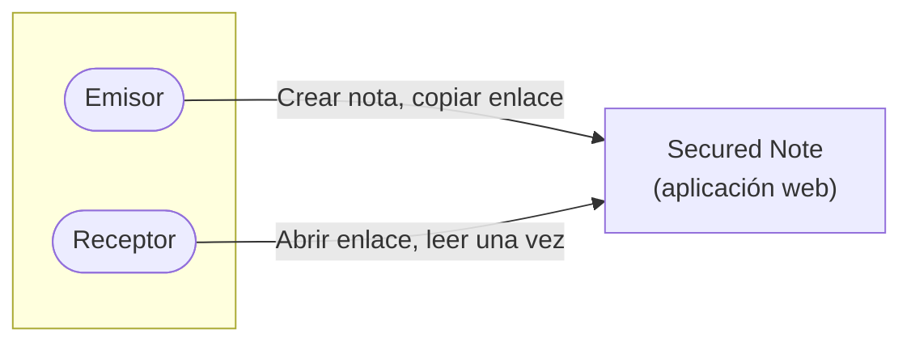
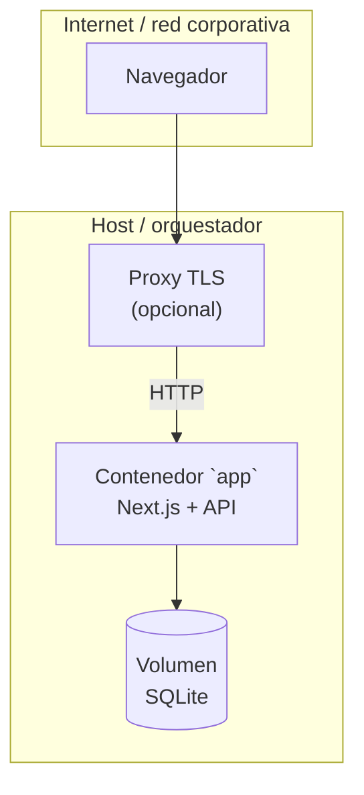
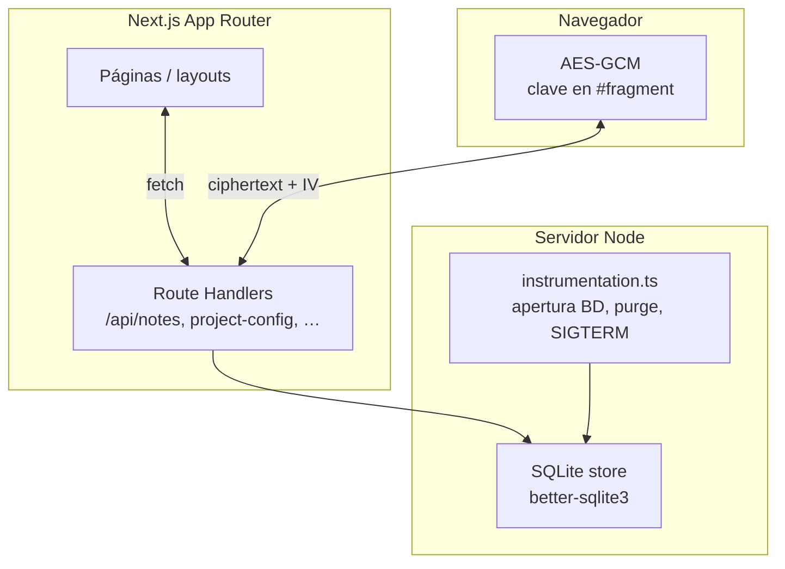

# Secured Note

**Notas confidenciales de un solo uso**, cifradas en el navegador y destruidas en el servidor tras la lectura. Arquitectura **zero-knowledge**: la clave nunca sale del cliente en claro; el backend solo almacena ciphertext.

---

## Tabla de contenidos

1. [Visión y alcance](#1-visión-y-alcance-c4--contexto)
2. [Arquitectura de despliegue](#2-arquitectura-de-despliegue-c4--contenedores)
3. [Arquitectura interna](#3-arquitectura-interna-c4--componentes)
4. [Stack tecnológico](#4-stack-tecnológico)
5. [Estructura del repositorio](#5-estructura-del-repositorio)
6. [Puesta en marcha](#6-puesta-en-marcha)
7. [Configuración](#7-configuración)
8. [Operación y observabilidad](#8-operación-y-observabilidad)
9. [Seguridad](#9-seguridad)
10. [Resolución de incidencias](#10-resolución-de-incidencias)
11. [Licencia y contribuciones](#11-licencia-y-contribuciones)

---

## 1. Visión y alcance (C4 — Contexto)

**Actores**

| Actor | Rol |
|--------|-----|
| **Usuario emisor** | Crea una nota, elige TTL opcional y opcionalmente contraseña; obtiene un enlace con fragmento de clave (`#`). |
| **Usuario receptor** | Abre el enlace, confirma lectura y (si aplica) introduce contraseña; ve el texto una vez. |
| **Administrador de plataforma** | Despliega el contenedor, configura TLS en el proxy y respalda el volumen de datos. |

**Sistema de software**

Secured Note es una aplicación web que expone UI y API en un único proceso, pensada para ejecutarse detrás de HTTPS en producción.



**Fuera de alcance del código**

- Terminación TLS, certificados y políticas de red: **proxy / balanceador / PaaS** delante del contenedor.
- Copias de seguridad del volumen SQLite: **procesos operativos** del equipo.

---

## 2. Arquitectura de despliegue (C4 — Contenedores)

Un único **contenedor de aplicación** ejecuta Node.js con Next.js en modo producción (salida `standalone`). La persistencia es un **archivo SQLite** montado en volumen.



| Contenedor / artefacto | Responsabilidad |
|------------------------|----------------|
| **`app`** | Sirve UI (App Router), API REST (`/api/…`), health/readiness, cifrado servidor solo para metadatos de contraseña (bcrypt). |
| **Volumen de datos** | Almacena `secured-note.db` (notas cifradas, configuración de proyecto, intentos de contraseña). |

Compose (`docker-compose.yml`) define el servicio `app`, variables vía `.env` en la raíz y publicación `HOST_PORT` → `APP_PORT`.

---

## 3. Arquitectura interna (C4 — Componentes)

Dentro del proceso Node.js los límites principales son:



| Componente | Ubicación típica | Función |
|------------|------------------|---------|
| **UI** | `web/app`, `web/components` | Creación de notas, lectura `/n/[id]`, modales (descargo, setup de marca). |
| **API HTTP** | `web/app/api/**` | POST notas, lectura destructiva, metadata, CSP report. |
| **Lógica de dominio** | `web/lib/server/*` | Validación, SQLite, headers de API, env. |
| **Cliente cripto** | `web/lib/crypto*` | Cifrado/descifrado en el navegador. |
| **Arranque / ciclo de vida** | `web/instrumentation.ts` | Inicializa BD y tareas programadas ligeras. |

El **nivel código** (clases/módulos finos) se explora directamente en el árbol fuente; no se duplica aquí.

---

## 4. Stack tecnológico

| Capa | Tecnología |
|------|------------|
| Runtime | Node.js 20 |
| Framework | Next.js 14 (App Router), React 18 |
| Lenguaje | TypeScript |
| Base de datos | SQLite (`better-sqlite3`), un writer |
| Estilo | Tailwind CSS 4 |
| Contenedor | Docker multi-stage, `dumb-init`, permisos `/data` vía entrypoint |
| Validación / logs | Zod, Pino |

---

## 5. Estructura del repositorio

```
.
├── .env.example              # Plantilla de variables (copiar a .env)
├── docker-compose.yml      # Servicio único `app`
├── scripts/
│   └── reset-project-config.sh  # Reiniciar asistente de setup (wizard)
└── web/
    ├── Dockerfile
    ├── app/                  # Rutas, layouts, API
    ├── components/         # UI reutilizable
    ├── lib/                  # Utilidades cliente y servidor
    ├── instrumentation.ts  # Arranque BD / purge
    └── package.json
```

---

## 6. Puesta en marcha

### Docker (recomendado producción / demo)

```bash
cp .env.example .env
# Ajustar WEB_ORIGIN, HOST_PORT, APP_PORT según tu URL y puertos

docker compose up -d --build
```

Aplicación: `http://localhost:<HOST_PORT>` (por defecto **3001**).

### Docker + Traefik (HTTPS en producción)

Para publicar detrás de un Traefik existente sin acoplar el compose base a un dominio concreto:

```bash
cp .env.example .env
# Añade las variables de `.env.traefik.example` (PUBLIC_HOST, TRAEFIK_CERT_RESOLVER, …)
# y alinea WEB_ORIGIN / NEXT_PUBLIC_SITE_URL con tu URL HTTPS pública.

docker compose -f docker-compose.yml -f docker-compose.traefik.example.yml up -d --build
```

Requisitos: red Docker externa `traefik-public`, Traefik con provider Docker y resolutor ACME, DNS del dominio apuntando al host. Define `HOST_BIND=127.0.0.1` en `.env` (ver `.env.traefik.example`) para publicar el puerto solo en localhost; Traefik enruta el tráfico HTTPS externo.

### Desarrollo local (sin Docker)

```bash
cd web
pnpm install
pnpm dev
```

Por defecto Next usa el puerto **3000**; alinea `WEB_ORIGIN` en `.env` (raíz). SQLite local suele residir en `web/data/secured-note.db` si no defines otra `SQLITE_PATH`.

---

## 7. Configuración

La referencia completa está en **[`.env.example`](.env.example)**. Resumen de variables frecuentes:

| Variable | Propósito |
|----------|-----------|
| `WEB_ORIGIN` | Origen del sitio (coherencia CSP/servidor); debe coincidir con la URL que ve el usuario. |
| `APP_PORT` / `HOST_PORT` | Docker: puerto interno del contenedor y mapeo en el host. |
| `HOST_BIND` | IP de enlace en el host (p. ej. `127.0.0.1` detrás de Traefik; vacío = todas las interfaces). |
| `SQLITE_PATH` | Ruta del fichero `.db` (en contenedor típicamente `/data/secured-note.db`). |
| `NEXT_PUBLIC_*` | Variables embebidas en el **build** del cliente; alinear con dominio público en CI/imagen. |
| `NEXT_PUBLIC_SITE_URL` | URL HTTPS pública (sin `/` final): CSP reporting, Open Graph, cabeceras relacionadas. |

**No commitear** el archivo `.env`.

### Precedencia: `.env` / build vs SQLite (`project_config`)

El modelo es **híbrido**: infraestructura por variables de entorno; marca y aviso legal por el asistente de setup (wizard) que persiste en SQLite. Resumen en la tabla siguiente.

| Capa | Cuándo aplica | Ejemplos | Cambio requiere |
|------|---------------|----------|-----------------|
| **Build-time** (`NEXT_PUBLIC_*`, args Docker) | Imagen / `pnpm build` | `NEXT_PUBLIC_SITE_URL`, `NEXT_PUBLIC_GA_*`, `NEXT_PUBLIC_GITHUB_REPO_URL`, `NEXT_PUBLIC_BRAND_*` (defaults) | Rebuild de imagen |
| **Runtime servidor** (`.env`, sin rebuild) | Arranque del contenedor | `WEB_ORIGIN`, `SQLITE_PATH`, `LOG_LEVEL`, `HSTS_*`, `NODE_ENV` | Reinicio del servicio |
| **Runtime SQLite** (`project_config`) | Tras el primer POST exitoso del wizard | `appName`, logo, colores, `disclaimer` | SQL manual o [reset del setup](#reiniciar-el-asistente-de-configuración-wizard) |
| **Traefik overlay** | Deploy producción | `PUBLIC_HOST`, `TRAEFIK_CERT_RESOLVER`, `HOST_BIND` | Editar `.env` + redeploy |
| **Solo documentación** | Procesos ops | Backups de volumen, rotación de logs | Manual |

**Reglas de precedencia (branding y disclaimer):**

1. Si existe fila en `project_config` → la app usa **SQLite** como fuente de verdad (nombre, colores, logo, aviso legal). Las variables `NEXT_PUBLIC_BRAND_*` solo actúan como fallback SSR inicial vía `DEFAULT_PROJECT_BRANDING`.
2. Si **no** existe `project_config` → se aplican los defaults de `NEXT_PUBLIC_BRAND_*` (o valores stock) y el wizard es **obligatorio** en la primera visita.
3. `WEB_ORIGIN` y `NEXT_PUBLIC_SITE_URL` deben coincidir con la URL pública (CSP, Open Graph, report-uri).

La API `POST /api/project-config` solo permite el **INSERT inicial** (write-once). Cambios posteriores requieren reset documentado o SQL directo; reconfiguración vía API está planificada en SEC-8.

---

## 8. Operación y observabilidad

| Endpoint | Uso |
|----------|-----|
| [`/api/health`](web/app/api/health/route.ts) | Salud lógica (JSON); usado por healthcheck Docker. |
| `/healthz` | Comprobación rápida. |
| `/readyz` | Listo cuando SQLite está operativo. |

Comandos útiles:

```bash
docker compose logs -f app
docker compose ps
docker compose down
docker compose down -v   # elimina también el volumen (pérdida de datos)
```

---

## 9. Seguridad

- Cabeceras HTTP configuradas en `web/next.config.mjs` (CSP, HSTS en producción con HTTPS, `Permissions-Policy`, etc.).
- API JSON con cabeceras restrictivas en `web/lib/server/api-headers.ts`.
- Contacto de seguridad: editar [`web/public/.well-known/security.txt`](web/public/.well-known/security.txt).
- **TLS** y versiones de protocolo se gestionan en el **proxy**, no en este repositorio.

---

## 10. Resolución de incidencias

| Síntoma | Acción |
|---------|--------|
| `/readyz` falla | `docker compose logs app`; comprobar volumen y `SQLITE_PATH`. |
| Push rechazado / historial remoto | Integrar con `git pull` (rebase o merge) antes de `git push`. |
| Reiniciar asistente de configuración (wizard) | Ver [Reiniciar el asistente de configuración (wizard)](#reiniciar-el-asistente-de-configuración-wizard) abajo. |

### Reiniciar el asistente de configuración (wizard)

El setup de instancia es **write-once**: tras completar el wizard, la fila `project_config` en SQLite bloquea un nuevo POST. Para volver a mostrar el asistente (marca + aviso legal):

**Opción recomendada — script oficial (Docker Compose en marcha):**

```bash
./scripts/reset-project-config.sh
```

El script:

1. Lee `.env` de la raíz (`COMPOSE_CONTAINER_NAME`, `SQLITE_PATH`).
2. Ejecuta `DELETE FROM project_config WHERE id = 1` dentro del contenedor vía `docker exec … sqlite3`.
3. Reinicia el servicio `app` con `docker compose restart app`.

Simular sin cambios: `./scripts/reset-project-config.sh --dry-run`.

**Desarrollo local sin Docker:**

```bash
SQLITE_PATH=web/data/secured-note.db ./scripts/reset-project-config.sh --local
```

Reinicia manualmente `pnpm dev` tras el reset local.

**Comprobación:** abre la app en una sesión limpia (o ventana privada). `GET /api/project-config` debe devolver `{"configured":false}` y el modal de setup debe aparecer.

**Manual (equivalente):**

```bash
docker exec secured-note-app sqlite3 /data/secured-note.db \
  "DELETE FROM project_config WHERE id = 1;"
docker compose restart app
```

> **Nota:** el reset **no** borra notas existentes; solo elimina la configuración de marca/aviso legal. Para borrar toda la base de datos, usa `docker compose down -v` (destructivo).

---

## 11. Licencia y contribuciones

[](LICENSE)

Este proyecto se publica bajo la **[licencia MIT](LICENSE)** (texto completo en `LICENSE`). El badge de imagen remoto (shields.io u otro) quedará pendiente hasta contar con repositorio público upstream.

Para proponer cambios: rama temática → pull request → `pnpm lint` y `pnpm test` en `web/`.

### Documentación self-host y operación

| Guía | Contenido |
|------|-----------|
| [`docs/QUICKSTART.md`](docs/QUICKSTART.md) | `.env` → `docker compose up` → URL → wizard (~5 min) |
| [`docs/ARCHITECTURE.md`](docs/ARCHITECTURE.md) | Mapa de módulos, API y flujo nota (create → link → lectura destructiva) |
| [`docs/OPERATIONS.md`](docs/OPERATIONS.md) | Backup volumen `/data`, logs, reset del wizard, troubleshooting |

---

**Documentación de arquitectura:** este README sigue una organización inspirada en el **modelo C4** (Contexto → Contenedores → Componentes). Los diagramas usan [Mermaid](https://mermaid.js.org/); Azure DevOps y GitHub los renderizan en la vista del fichero.

**Stack resumido:** Next.js 16 · React 18 · SQLite · TypeScript · Docker.
