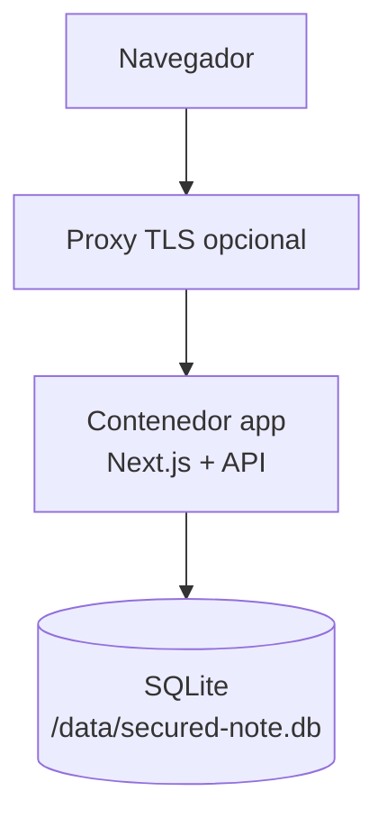
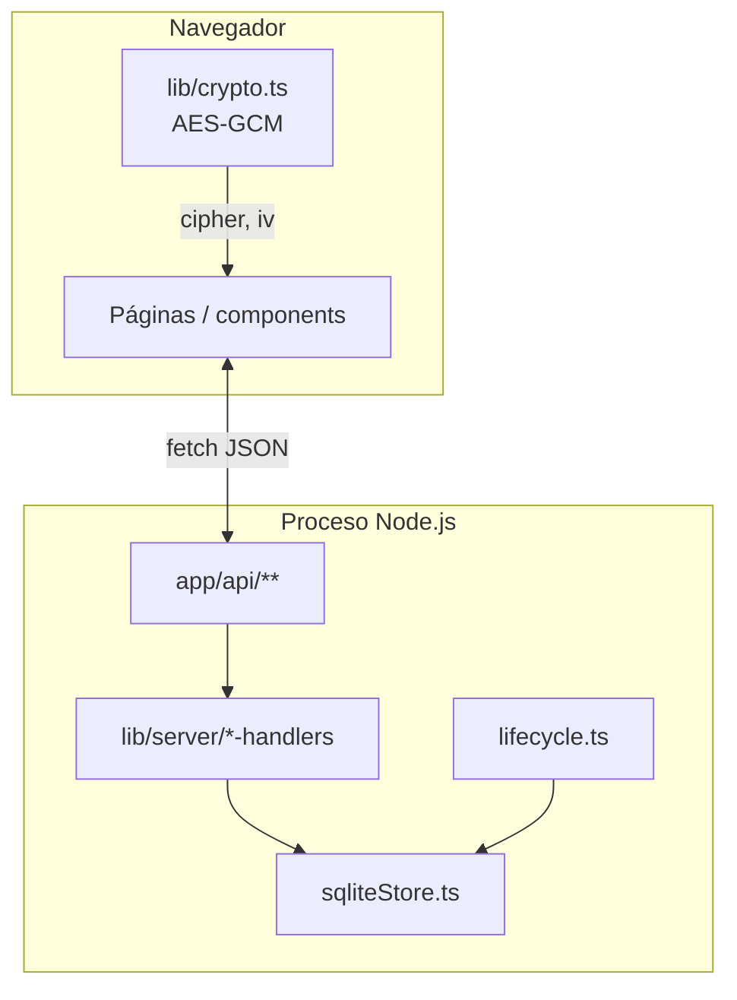

# Arquitectura

Visión técnica de **Secured Note** para self-hosters y contributors. El README principal sigue el modelo C4 (Contexto → Contenedores → Componentes); este documento profundiza en **módulos**, **API** y el **flujo de una nota**.

## Principios

| Principio | Implementación |
|-----------|----------------|
| **Zero-knowledge** | El texto en claro se cifra en el navegador (AES-GCM). El servidor solo almacena `cipher` + `iv`. |
| **Lectura destructiva** | Tras la primera lectura exitosa (sin TTL), la fila se elimina de SQLite. |
| **Clave fuera del servidor** | La clave simétrica viaja en el fragmento URL (`#...`), que no se envía al servidor en peticiones HTTP. |
| **Monolito simple** | Un proceso Node.js (Next.js 14 App Router) + un archivo SQLite en volumen `/data`. |

## Despliegue (resumen)



TLS, certificados y políticas de red viven en el proxy; ver [README §2](../README.md#2-arquitectura-de-despliegue-c4--contenedores).

## Mapa de módulos

```
web/
├── app/
│   ├── page.tsx                    # Creación de notas (UI emisor)
│   ├── n/[id]/page.tsx             # Lectura de nota (UI receptor)
│   ├── layout.tsx, providers.tsx   # Shell, branding, i18n
│   ├── healthz/, readyz/           # Probes ligeras
│   └── api/
│       ├── notes/
│       │   ├── route.ts            # POST crear nota
│       │   └── [id]/
│       │       ├── route.ts        # POST lectura destructiva
│       │       └── metadata/route.ts  # GET metadatos (sin ciphertext)
│       ├── project-config/route.ts # GET/POST setup instancia (write-once)
│       ├── health/route.ts         # Salud JSON (Docker healthcheck)
│       └── csp-report/route.ts     # Ingesta reportes CSP
├── components/
│   ├── project-setup-modal.tsx     # Wizard marca + aviso legal
│   └── …                           # UI compartida (formularios, modales)
├── lib/
│   ├── crypto.ts                   # AES-GCM en cliente (Web Crypto)
│   ├── project-branding.ts         # Defaults NEXT_PUBLIC_BRAND_*
│   ├── branding-provider.tsx       # Estado de marca / setup
│   └── server/
│       ├── notes-handlers.ts       # Lógica crear/leer/metadata
│       ├── project-config-handlers.ts
│       ├── sqliteStore.ts          # Persistencia, purge TTL, intentos password
│       ├── api-request-guards.ts   # Límites tamaño, Content-Type
│       ├── api-headers.ts          # Cabeceras restrictivas en respuestas API
│       ├── env.ts                  # Validación Zod de variables
│       └── lifecycle.ts            # Arranque BD, purge programado, SIGTERM
└── instrumentation.ts              # Hook Next.js → startSqliteLifecycle()
```

## Componentes internos



| Módulo | Responsabilidad |
|--------|-----------------|
| `crypto.ts` | Generar/importar clave, cifrar y descifrar en cliente. |
| `notes-handlers.ts` | Validar payloads, bcrypt de contraseña opcional, borrado tras lectura. |
| `sqliteStore.ts` | Tablas `notes`, `project_config`, intentos de contraseña; purge por TTL. |
| `project-config-handlers.ts` | INSERT inicial de configuración de instancia (409 si ya existe). |
| `instrumentation.ts` + `lifecycle.ts` | Abrir BD al arranque, tareas de mantenimiento, cierre limpio. |

## Flujo de una nota (create → link → read destructivo)

```mermaid
sequenceDiagram
  participant E as Emisor (navegador)
  participant API as API /api/notes
  participant DB as SQLite
  participant R as Receptor (navegador)

  Note over E: Genera clave AES en cliente
  E->>E: Cifra texto → cipher + iv
  E->>API: POST /api/notes { cipher, iv, ttl?, password? }
  API->>API: Valida base64, tamaño, bcrypt(password?)
  API->>DB: INSERT nota (id UUID)
  API-->>E: 201 { id, ttl, hasPassword }
  E->>E: Construye enlace /n/{id}#{clave}

  Note over R: Abre enlace; clave AES en fragmento # (no viaja al servidor)
  R->>API: GET /api/notes/{id}/metadata
  API->>DB: SELECT (sin borrar)
  API-->>R: { hasPassword, expiresIn, … }
  R->>R: Usuario confirma lectura destructiva
  R->>API: POST /api/notes/{id} { password? }
  API->>DB: SELECT fila
  alt Contraseña incorrecta
    API-->>R: 401 (+ rate limit por IP)
  else Lectura OK
    alt Sin TTL
      API->>DB: DELETE nota
    end
    API-->>R: { cipher, iv, salt }
    R->>R: Descifra cipher+iv con clave del fragmento #
  end
```

### Detalle por fase

**1. Creación (emisor)**

- La UI (`app/page.tsx`) genera una clave AES-256 y cifra el texto con `encryptText()` / `encrypt()`.
- Solo se envía al servidor el ciphertext; la clave exportada en base64 queda en el fragmento `#` del enlace.
- `POST /api/notes` persiste JSON `{ cipher, iv, salt, passwordHash?, createdAt }` con TTL opcional (máx. 30 días).

**2. Enlace**

- Formato: `{WEB_ORIGIN}/n/{uuid}#{clave-base64}`.
- El fragmento `#` **no** viaja al servidor en la petición HTTP inicial; el receptor debe tener el enlace completo.

**3. Metadatos (receptor, previo a leer)**

- `GET /api/notes/{id}/metadata` devuelve si hay contraseña adicional y tiempo restante de TTL, sin exponer el ciphertext hasta la lectura confirmada.

**4. Lectura destructiva**

- `POST /api/notes/{id}` valida contraseña opcional (bcrypt, máx. 3 intentos por IP con lockout).
- Si la nota **no** tiene TTL basado en tiempo, `deleteNote(id)` se ejecuta **antes** de devolver el ciphertext.
- Si tiene TTL, la nota permanece hasta expiración (purge en `lifecycle.ts`).
- El servidor responde `{ cipher, iv, salt }`; solo entonces el cliente (`app/n/[id]/page.tsx` → `decrypt()`) descifra con la clave del fragmento `#`.

## API HTTP (notas y setup)

| Método | Ruta | Uso |
|--------|------|-----|
| `POST` | `/api/notes` | Crear nota (body: `cipher`, `iv`, `ttl?`, `password?`) |
| `GET` | `/api/notes/{id}/metadata` | Metadatos sin borrar |
| `POST` | `/api/notes/{id}` | Lectura; borrado si no hay TTL |
| `GET` | `/api/project-config` | `{ configured: boolean, … }` |
| `POST` | `/api/project-config` | Primer setup (409 si ya configurado) |
| `GET` | `/api/health` | Salud para Docker |
| `GET` | `/healthz`, `/readyz` | Probes |

## Configuración: capas

| Capa | Dónde | Ejemplos |
|------|-------|----------|
| Build-time | `NEXT_PUBLIC_*`, args Docker | `NEXT_PUBLIC_SITE_URL`, `NEXT_PUBLIC_BRAND_*` |
| Runtime servidor | `.env` | `WEB_ORIGIN`, `SQLITE_PATH`, `LOG_LEVEL` |
| Runtime SQLite | Wizard → `project_config` | `appName`, colores, disclaimer |

Matriz completa y precedencia en [README §7 — Precedencia](../README.md#7-configuración).

## Seguridad (puntos de extensión)

- Cabeceras HTTP: `web/next.config.mjs`, `web/lib/server/api-headers.ts`.
- Contacto de divulgación: `web/public/.well-known/security.txt`.
- TLS y HSTS en producción: proxy delante del contenedor; `HSTS_*` en runtime.

## Referencias

- [README — C4 completo](../README.md)
- [OPERATIONS.md](OPERATIONS.md) — backup, logs, reset
- [OSS_READINESS.md](OSS_READINESS.md) — roadmap y gaps OSS
